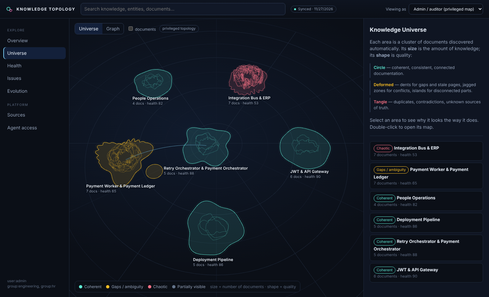

# Knowledge Topology

Generyczna platforma do **mapowania, oceny jakości i udostępniania wiedzy** organizacji — dla ludzi
(interaktywna mapa) i dla agentów AI (MCP + REST).

Zamiast kazać agentowi przeszukiwać Confluence przy każdym pytaniu (drogo w tokenach), platforma
raz indeksuje źródła, buduje z nich **topologię wiedzy** i oddaje agentowi tylko minimalny, cytowany
kontekst. Ta sama topologia pokazuje ludziom, gdzie dokumentacja jest spójna, a gdzie jest chaosem:

| Kształt | Znaczenie | Z czego wynika |
| --- | --- | --- |
| **Okrąg** | spójna, aktualna, powiązana wiedza | wysokie metryki we wszystkich wymiarach |
| **Zdeformowany okrąg** | luki, nieaktualne strony, niejasności | wcięcia (gaps/freshness), poszarpane strefy (konflikty), wyspy (brak połączeń) |
| **Splątany kłębek** | duplikaty, sprzeczności, brak źródła prawdy | wysoki *chaos index* → liczba i amplituda „nici” |

Kształt jest **deterministyczną reprezentacją zmierzonych metryk** — każda deformacja ma wyjaśnienie
z metryką, dokumentami i zgłoszeniem (issue). Rozmiar obszaru = skala wiedzy, nie jakość.



## Co jest w tym repozytorium (Vertical Slice 01)

- **Connectory** z jednym kontraktem: Confluence Cloud (REST v2 + CQL + restrykcje stron, paginacja kursorowa,
  dziedziczenie restrykcji przodków) oraz folder Markdown/HTML.
- **Ingestion** przyrostowy i idempotentny: wersje dokumentów, hash treści, zmiana ACL bez re-embeddingu,
  usunięcia z zachowaniem historii, reconciliation, webhook Confluence.
- **Semantic layer**: chunking świadomy struktury (nagłówki, tabele, kod), wymienne embeddingi
  (`hashing` do demo/testów, **BGE-M3 lokalnie**, OpenAI), Qdrant lub lokalny store, BM25.
- **Knowledge Topology Engine**: graf wielosygnałowy `W = α·semantic + β·entity + γ·link + δ·context`,
  klasteryzacja hybrydowa (Leiden/Louvain + HDBSCAN), podobszary, stabilne ID klastrów (lineage),
  8 metryk jakości z confidence, wykrywanie sprzeczności/duplikatów/luk/sierot, Geometry Engine,
  stabilny layout, wersjonowane snapshoty.
- **Retrieval** hybrydowy (wektor + BM25, RRF) z autorytatywnym ACL, budżetem tokenów i ostrzeżeniami
  jakości (np. „to źródło jest sprzeczne z innym”).
- **REST API** (`/api/v1`, FastAPI, OpenAPI pod `/docs`) i **serwer MCP** (15 narzędzi, stdio lub HTTP) —
  oba na tej samej warstwie usług domenowych.
- **Web UI** (React + Three.js): Overview, Universe 3D ⇄ Graph 2D, mapa obszaru z „Explain this connection”,
  macierz Health, Issue Explorer z workflow, Evolution (porównanie snapshotów), Sources, Agent access.
- **Bezpieczeństwo od pierwszego dnia**: ACL w wyszukiwaniu, grafie, mapie, metrykach, issues i MCP;
  obszary częściowo widoczne nie ujawniają metryk ani kształtu; 404 nieodróżnialne od braku uprawnień; audyt.
- **32 testy** (parsowanie, ingestion, jakość topologii na oznaczonym korpusie, 7 scenariuszy ACL, API,
  Confluence na mockowanym API, MCP, Qdrant) + migracje Alembic (SQLite i PostgreSQL).

## Szybki start na Windows (bez Dockera)

Wymagania: Python 3.11+ i Node.js 20+.

```powershell
git clone <repo> knowledge-topology; cd knowledge-topology
powershell -ExecutionPolicy Bypass -File scripts\setup.ps1
powershell -ExecutionPolicy Bypass -File scripts\demo.ps1
```

Otwórz <http://127.0.0.1:8000>. W prawym górnym rogu przełączasz tożsamość (klucze deweloperskie):
admin widzi pełną mapę, „Eva — Engineering” nie widzi w ogóle obszaru HR — to jest ta sama baza,
filtrowana po stronie serwera.

Demo ładuje `demo/corpus` (30 dokumentów: spójna Identity, Payments z lukami i konfliktem
„retry 3 vs 5”, chaotyczny Legacy ERP, Platform, HR z ograniczonym dostępem), buduje snapshot,
po czym dokłada `demo/corpus-update` (nowa platforma płatności) i buduje drugi snapshot — w widoku
**Evolution** widać nowy obszar, spadek spójności Payments i konflikt między starą a nową polityką retry.

## Uruchomienie z Dockerem (PostgreSQL + Qdrant)

```powershell
copy .env.example .env
docker compose up -d --build
docker compose run --rm demo      # opcjonalnie: korpus demo + klucze deweloperskie w .\data
```

UI/API: <http://127.0.0.1:8000>, Qdrant: `127.0.0.1:6333`, PostgreSQL: `127.0.0.1:5432` — wszystkie porty
tylko lokalnie. Schemat bazy zarządzany przez Alembic (`alembic upgrade head` przy starcie kontenera).

## Własna dokumentacja

```powershell
cd backend
.\.venv\Scripts\kt.exe init                      # tworzy bazę i losowy klucz admina w data\api-keys.json
# Folder z Markdown/HTML
.\.venv\Scripts\kt.exe source add filesystem --name "Wiki" --path C:\docs\wiki --groups group:engineering
# Confluence Cloud (token tylko w zmiennej środowiskowej)
$env:CONFLUENCE_API_TOKEN = "<token>"
.\.venv\Scripts\kt.exe source add confluence --name ENG --base-url https://twoja-firma.atlassian.net `
    --email bot@firma.pl --spaces ENG,PAY --space-principals '{"ENG": ["group:engineering"]}'
.\.venv\Scripts\kt.exe sync            # przyrostowo; --full = pełny import
.\.venv\Scripts\kt.exe worker          # cykliczny sync + przebudowa topologii, gdy coś się zmieniło
```

Do realnej dokumentacji użyj prawdziwego modelu embeddingów (lokalnie, bez wysyłania treści poza firmę):

```powershell
scripts\setup.ps1 -LocalEmbeddings
$env:KT_EMBEDDING_PROVIDER = "sentence-transformers"; $env:KT_EMBEDDING_MODEL = "BAAI/bge-m3"
$env:KT_RETRIEVAL_VECTOR_ONLY_MIN = "0.5"
kt sync --full        # zmiana modelu = pełna reindeksacja
```

## Podłączenie istniejącego agenta (MCP)

```powershell
scripts\mcp-config.ps1 -ApiKey dev-agent-key
```

wkleja się do konfiguracji MCP agenta (stdio, `kt mcp`). Tożsamość agenta pochodzi z klucza połączenia
(`KT_MCP_API_KEY`), nigdy z argumentów narzędzi. Migracja bez przebudowy agenta (strangler pattern),
polityka dla system promptu i pomiar oszczędności tokenów: **[docs/mcp-integration.md](docs/mcp-integration.md)**.

Odpowiedzi MCP są kompaktowe (JSON bez wcięć i nulli), mają budżet tokenów i zwracają 2 najlepsze
fragmenty na dokument zamiast całych stron.

## Dokumentacja

| Dokument | Treść |
| --- | --- |
| [docs/architecture.md](docs/architecture.md) | komponenty, przepływ danych, model danych, hybrid deployment |
| [docs/topology-algorithm.md](docs/topology-algorithm.md) | graf, klasteryzacja, metryki, geometria, lineage, kalibracja |
| [docs/mcp-integration.md](docs/mcp-integration.md) | narzędzia MCP, polityka agenta, migracja, pomiar tokenów |
| [docs/security.md](docs/security.md) | model ACL, autoryzacja wizualizacji, scenariusze testowe |
| [docs/roadmap.md](docs/roadmap.md) | co jest zrobione, a co w kolejnych etapach |
| [docs/adr/](docs/adr/) | Architecture Decision Records 001–012 |

## Struktura repozytorium

```
backend/                Python 3.11+ (pakiet `kt`, CLI `kt`)
  kt/connectors/        kontrakt connectora + Confluence Cloud + filesystem
  kt/ingestion/         parsowanie (storage format, Markdown) i synchronizacja przyrostowa
  kt/semantic/          chunking, embeddingi, BM25
  kt/storage/           Qdrant / lokalny vector store
  kt/entities/          encje, aliasy-kandydaci, twierdzenia liczbowe (claims)
  kt/topology/          graf, klasteryzacja, metryki, geometria, layout, lineage, widoki z ACL
  kt/intelligence/      issues z dowodami i rekomendacjami
  kt/retrieval/         wyszukiwanie hybrydowe z budżetem tokenów
  kt/access/            autorytatywna kontrola dostępu
  kt/services.py        jedna fasada usług dla REST i MCP
  kt/api/               FastAPI (REST v1, model błędów, trace_id, webhooki)
  kt/mcp/               serwer MCP (stdio / streamable HTTP)
  migrations/           Alembic
  tests/                pytest
web/                    React + TypeScript + Three.js
demo/                   oznaczony korpus demonstracyjny (+ aktualizacja do demo ewolucji)
docs/                   architektura, algorytm, MCP, bezpieczeństwo, ADR
scripts/                PowerShell (setup, demo, konfiguracja MCP)
```

## Rozwój

```bash
cd backend && pip install -e ".[dev]" && pytest -q
cd web && npm ci && npm run dev        # Vite na :5173, proxy /api -> :8000
```
